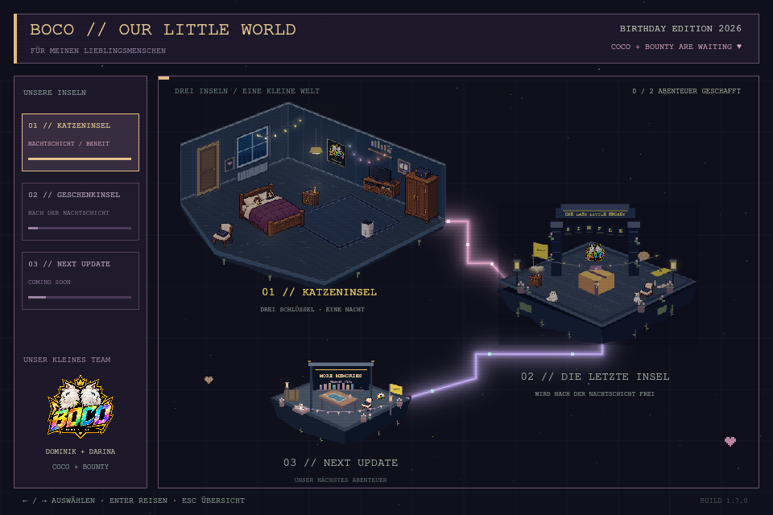

# TEAM BOCO // DOMINIK 2026

Version **1.8.0**. Ein zusammenhängendes, persönliches Pixel-Geburtstagsspiel:
Papier-Caesar → Weltkarte → Katzeninsel → Vigenère-Insel → PC-Geburtstagsgruß.
Der dritte Inselplatz ist ein detaillierter, besuchbarer Zukunftsort ohne Pflichtaufgabe.



Russische Anleitung: [START_HERE_RU.md](START_HERE_RU.md).

## Spiel und Vorschau

Die normale Website beginnt mit genau einem Papier-Eingang. SIMPLE oder die ganze
entschlüsselte Caesar-Nachricht öffnet die Welt. Groß-/Kleinschreibung und Leerzeichen
sind egal. Der Schlüssel bleibt in der Browser-Tab-Sitzung erhalten und wird
auf der Vigenère-Insel automatisch eingesetzt. Es gibt keinen zweiten Eingangsbildschirm.

BOCO_PREVIEW.html ist die separate Vorschau für Darina: direkt auf einem Computer
im Browser öffnen, ohne Papier-Schlüssel oder Server. Die untere Vorschau-Leiste
öffnet Welt, Katzen, Rätsel, Geburtstagsgruß, Zukunftsinsel oder Eingang direkt.
Sie benutzt eigenen flüchtigen Speicher und verändert den echten Spielstand nicht.
Die normale Website zeigt diese Vorschau-Leiste nicht.

Für die normale Mehrdateien-Version in PhpStorm index.html mit Open in Browser
öffnen, oder mit installiertem Node.js:

```bash
npm start
```

Dann http://127.0.0.1:5500/ öffnen. Dafür ist kein npm install erforderlich.
Auf dem iPhone die veröffentlichte Website verwenden; die lokale HTML-Vorschau
in Dateien führt das Spiel nicht zuverlässig aus.

## Welt und Kamera

Ein Klick auf eine Insel oder die linke Liste nähert die Kamera weich an.
Die scharfe Pixelgrafik bleibt erhalten. INSEL BETRETEN startet die Reise;
ein zweiter Klick auf die ausgewählte Insel geht ebenfalls. Links/rechts oder
1/2/3 wählen, Enter fliegt zur Insel. Esc oder ÜBERSICHT entfernt die Kamera.
Plus/Minus, Mausrad und Ziehen ergänzen den Zoom. Reduced Motion wird berücksichtigt.
Auf einem Touch-Gerät im Hochformat liegen die Zoomtasten unter dem Bild.

Die Verbindungen haben mehrere sanfte Neonlagen und wandernde Lichtpunkte.
Alle drei Inseln sind verbunden. Über Katzeninsel schweben animierte Herzen,
über Geschenkinsel Lichtsterne und über der Zukunftsinsel echte 0/1-Zeichen.
Velvet-Sky mit Pixel-Nebelwolken, mehrere Girlanden und flackernde Kerzen
sind dekorativ und verändern keine Kollisionen oder Rätsel.
Alle Inseln teilen eine 480×320-Pixelbasis. Raum: schwebendes Fundament, Bücherregal,
Katzenportrait, Möbel und lebendige Lampen. Finale: Lesetisch, Decoder-Rad, Bücher,
Pflanzen und der Geburtstags-PC. Zukunft: Werkbank, Plan, Bücher, Katzenkorb,
Wimpel und Laternen; mit WELTKARTE oder Esc zurückkehren.

## Ablauf

Auf der Katzeninsel: Enter/Klick steht auf, WASD/Pfeile bewegen,
E halten nimmt eine nahe Katze auf. Zur leuchtenden Tür laufen.
Die erste Katze kehrt einmal zurück: insgesamt drei Lieferungen.
Esc öffnet die Weltkarte, R startet die Nacht neu. Fokusverlust pausiert das Level.

Nach dem Sieg wartet Insel 2. Dort den Vigenère mit der gedruckten Tabelle lösen
und BOMBSITE A eingeben oder den bereits eingesetzten Schlüssel im animierten
Decoder verwenden. GESCHENK ENTDECKEN zeigt danach den PC und Darinas Gruß.
Keine zusätzliche Binär-Code-Abfrage. Der vorhandene Koffer-Code 3427 bleibt
als aufklappbarer Hinweis im fertigen Gruß.

## Veröffentlichen und prüfen

Ziel: https://dashulya27.github.io/team-boco-2026/
Paketinhalt in den bestehenden Klon kopieren, .git behalten, Commit/Push in PhpStorm.
Diese lokale Version wurde nicht automatisch veröffentlicht. Der bisherige QR
bleibt passend, wenn er auf diese Adresse zeigt; eine vorhandene Papierkopie wurde
nicht gescannt.

```bash
npm test
npm install
npm run build:room
npm run build:preview
npm run test:render
```

Standardtests benötigen nur Node.js und prüfen den Papier-Eingang, Kamera-Geometrie,
Spielablauf, Vigenère und Dateien. Der Canvas-Integrationstest nutzt @napi-rs/canvas:
tatsächlicher Eingang → Zoom und Trefferprüfung → drei Katzenlieferungen →
Kartenflug → automatischer Schlüssel → PC-Gruß → Zukunftsinsel und Vorschau.
Die Bilder in docs/previews sind Canvas-Ausgaben, keine Browser-Screenshots.
Die neue Oberfläche wurde hier nicht im Browser/Safari geprüft.

Optional auf einem Computer mit Browserzugriff:

```bash
npx playwright install chromium
npm run test:browser
```
